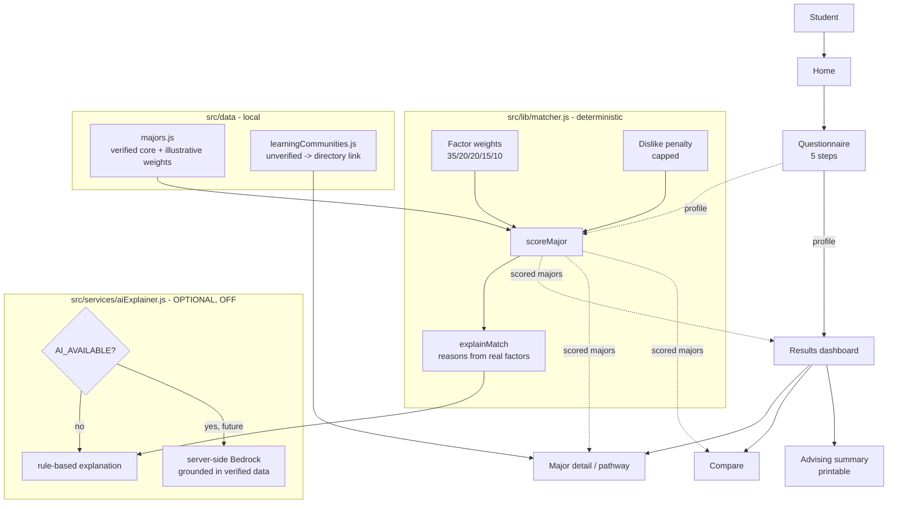

# Architecture — ISU Major & Learning-Community Matcher

Hackathon prototype · Team 2 · Use Case 3

## Overview

A client-only React + Vite single-page app. All logic and data run in the browser; there is no
backend, database, or external service, which keeps the demo reliable and avoids handling any real
student data. An optional server-side AI layer is designed for but not enabled (see below).

## Components and pages

| Layer | File | Responsibility |
|---|---|---|
| Shell | `src/App.jsx` | View-state navigation, holds profile, moves focus on nav |
| Page | `pages/Home.jsx` | Welcome + process overview + "Find My Major" |
| Page | `pages/Questionnaire.jsx` | Five-step guided form, progress, validation |
| Page | `pages/Results.jsx` | Ranked majors, show-all, compare selection, summary entry |
| Page | `pages/MajorDetail.jsx` | Academic focus, careers, learning communities, pathway |
| Page | `pages/Compare.jsx` | Side-by-side table of 2–3 majors |
| Page | `pages/AdvisingSummary.jsx` | Printable summary + advisor questions |
| Component | `components/ProgressBar.jsx` | Step indicator (`progressbar` role) |
| Component | `components/ChipGroup.jsx` | Accessible multi-select chips |
| Component | `components/FitMeter.jsx` | Score meter + qualitative band |
| Component | `components/FactorBreakdown.jsx` | Per-factor contribution bars |
| Component | `components/MajorCard.jsx` | Expandable recommendation card |
| Component | `components/LearningCommunities.jsx` | Community cards + directory link |
| Engine | `lib/matcher.js` | Weighted scoring, penalty, explanations |
| Tests | `lib/matcher.test.mjs` | 10 engine checks, run with `npm test` |
| Service | `services/aiExplainer.js` | Optional AI layer, grounded, off by default |

## Scoring model (why it is defensible)

- **Normalized, weighted overlap** across five factors with documented weights that sum to 1.
- **Reproducible**: same input → same output (a test asserts this).
- **Explainable**: the reasons shown are generated from the actual factor contributions, so the
  narrative can never drift from the number.
- **Fair to negative preferences**: a disliked activity applies a *capped* penalty (down-rank, not
  eliminate), and the UI states which dislike caused it.
- **Honest framing**: scores are shown as "overlap / 100" with a qualitative band, never as a
  probability of success.

## Why no router / UI framework

The journey is linear and small. A view-state enum in `App.jsx` keeps the bundle light and the
behavior obvious, matching the brief's "fewer screens done well" and "avoid large UI frameworks
solely for polish." Swapping in React Router later is a contained change.

## Data verification policy

- `majors.js`: `verification.status = 'verified-core'` means name, college, overview, and catalog
  URL were confirmed on catalog.iastate.edu (2025-11-17). Weights are labeled illustrative.
- `learningCommunities.js`: every association is `status: 'unverified'`; the UI labels it and links
  to the official directory. Nothing is presented as a guaranteed match.
- Course numbers are omitted pending verification of ISU's new 4-digit numbering; the detail page
  links to the official four-year plan.

## Security / privacy / accessibility

- No real student data collected; "Demo data" banner always visible.
- No backend, no credentials in the browser; the AI path is designed to be server-side only.
- WCAG-minded: semantic HTML, skip link, labelled controls, `aria-pressed`, `progressbar`/`meter`
  roles, visible focus, focus management on navigation, responsive type, print stylesheet.

## Limitations

1. **Small data subset** — 8 majors; the catalog has hundreds. Schema supports expansion.
2. **Learning communities unverified** — need a pass against the official directory to mark verified.
3. **No verified course lists** — intentionally omitted; links out instead.
4. **AI explanation not live** — needs a backend endpoint and Bedrock access; stub is in place.
5. **No degree audit / credit carryover / graduation date** — out of scope by design; these require
   advisor review of a real record.
6. **Live browser smoke test not run in this environment** — the CI sandbox blocks loopback HTTP;
   validated via production build (all modules transform) and engine unit tests. Run `npm run dev`
   locally to confirm interactively.

## Next steps toward an ISU pilot

1. Expand and verify the majors dataset from the catalog; add verified intro courses and four-year
   plan links per major.
2. Verify learning-community associations against the official directory; flip verified entries.
3. Stand up a small backend (FastAPI or Lambda) for the optional Bedrock explanation and a
   catalog-grounded RAG chatbot, as described in the team's Tech Spec.
4. Add credit-carryover and time-to-degree *guidance* (not a calculated date) with advisor review.
5. Pilot with Advising / EUReCA; add consented profile sharing for advising meetings.
