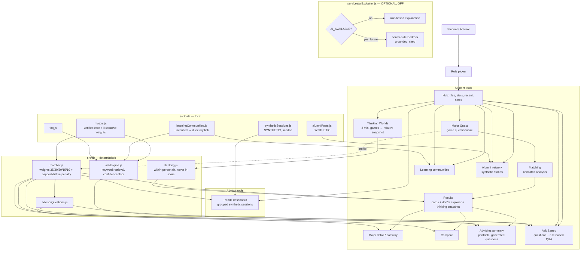

# Architecture — HelloMajor hub

Hackathon prototype · Team 2 · Use Case 3

## Overview

A client-only React + Vite single-page app organised as a hub with a sidebar of tools and a
Student / Advisor view switch. All logic and data run in the browser; there is no backend, database,
login or external service, which keeps the demo reliable and avoids handling any real student data.
The synthetic profile, chosen role, theme and recently viewed majors persist in `localStorage` under
a `fitfinder.` prefix so every tab survives a reload. An optional server-side AI layer is designed
for but not enabled.

## Shell and navigation

`App.jsx` holds `role`, `theme`, `view`, `profile`, `recent` and a `go(view, payload)` helper. The
sidebar (`.side`) lists tools per role; on narrow screens it becomes a sticky top bar with a
horizontally scrolling tab row. There is no router: the journey is small and a view-state enum keeps
the bundle light. Swapping in React Router later is a contained change.

| Layer | File | Responsibility |
|---|---|---|
| Shell | `App.jsx` | Sidebar tabs, role switch, theme, persistence, view-state nav, focus on nav |
| Page | `pages/Hub.jsx` | Role picker, stats, tool tiles, recent timeline, notes (student + advisor) |
| Page | `pages/Quest.jsx` | Game questionnaire (unchanged engine contract; don'ts stage emphasised) |
| Page | `pages/Worlds.jsx` | Number Forge, Logic Lab, Idea Garden; world map; soft timer |
| Page | `pages/Results.jsx` | Cards + `DislikeExplorer` + `ThinkingSnapshot` / worlds CTA |
| Page | `pages/Communities.jsx` | All community references, college filter, verification badges |
| Page | `pages/Alumni.jsx` | Stories, role badges, people-like-you, votes, local compose |
| Page | `pages/Ask.jsx` | Generated advisor questions; rule-based catalog Q&A thread |
| Page | `pages/AdvisorDashboard.jsx` | Stat tiles, bar charts, segmented bar, session prep cards |
| Component | `components/DislikeExplorer.jsx` | What-if toggles re-running `matchMajors` live |
| Component | `components/BarChart.jsx`, `SegmentedBar.jsx`, `StatTile.jsx` | Data-viz primitives |
| Engine | `lib/matcher.js` | Weighted scoring, penalty, explanations (unchanged) |
| Lib | `lib/askEngine.js` | Tokenise → score knowledge cards → answer with source or "unsure" |
| Lib | `lib/advisorQuestions.js` | Profile-driven question templates with a "why" per question |
| Lib | `lib/thinking.js` | Original mini-game items; relative snapshot; fluency count |
| Tests | `lib/matcher.test.mjs`, `lib/hub.test.mjs` | 22 checks, `npm test` |

## Design system

Neutral surfaces with cardinal/gold accents, inspired by a clean dashboard "login hub" layout:
sticky sidebar, product tiles with a round "go" button, a stats row, pill buttons, tabs, and a
light/dark theme set before first paint (`index.html`) and toggled from the sidebar. Headings use
Inter Tight, body Inter. Tailwind v4 is loaded **without preflight** (theme + utilities only) so the
existing component CSS keeps its list bullets and button defaults; utilities are for one-off layout.

Charts follow the data-viz method used in the team: nominal bars take one hue (no legend; the title
names the measure), the status split is a thin segmented bar with fixed slot order and a legend, all
values are labelled, every chart has a hover tooltip and a table toggle, and the two chart hues were
run through the palette validator in both themes (dark gold stepped to `#a0782a` to pass the
lightness band; its CVD warn is covered by the legend, labels and 2px gaps).

## Scoring model (why it is defensible)

- **Normalized, weighted overlap** across five factors with documented weights that sum to 1.
- **Reproducible**: same input → same output (tested).
- **Explainable**: reasons are generated from the actual factor contributions.
- **Fair to negative preferences**: a disliked activity applies a *capped* penalty (down-rank, not
  eliminate); the don'ts explorer lets students see exactly what each one changed.
- **Thinking snapshot is separate**: a test asserts it never changes a fit score.
- **Honest framing**: scores are "overlap / 100" with a qualitative band, never a probability.

## Data verification policy

- `majors.js`: `verification.status = 'verified-core'` = name, college, overview and catalog URL
  confirmed on catalog.iastate.edu. Weights are labelled illustrative.
- `learningCommunities.js`: every association is `unverified`; UI labels it and links the directory.
- `faq.js`: general guidance only; each answer links an official ISU page.
- `alumniPosts.js`, `syntheticSessions.js`: synthetic, labelled in the UI and in code.
- Course numbers omitted pending verification of ISU's 4-digit numbering.

## Security / privacy / accessibility

- No login, no real student data; "Demo data" badge always visible; one-click demo reset.
- No backend, no credentials in the browser; AI path is designed to be server-side only.
- Advisor view shows grouped counts and anonymous session ids only.
- Semantic HTML, skip link, labelled controls, `aria-pressed` / `aria-current`, visible focus,
  focus management, soft timers, reduced-motion support, chart table views, print stylesheet.

## Limitations

1. Small data subset (8 majors); schema supports expansion.
2. Learning-community associations unverified.
3. Alumni stories and advisor sessions are synthetic.
4. Q&A is keyword retrieval, not RAG; AI explanation not live.
5. Thinking Worlds: three items per world — a reflection aid with a wide band, not an assessment.
6. No degree audit / credit carry-over / graduation date, by design.
7. Browser smoke test: run `npm run dev` locally and walk the demo (docs/demo-walkthrough.md).

## Next steps toward an ISU pilot

1. Expand and verify majors; add verified intro courses and four-year plan links.
2. Verify learning-community associations; flip entries to `verified`.
3. Stand up the FastAPI/Lambda backend from the Tech Spec: Bedrock explanation + catalog RAG.
4. Verified accounts (Cognito) and a moderation queue for the alumni network.
5. Advisor dashboard on real, consented, grouped data (groups ≥ 10).
